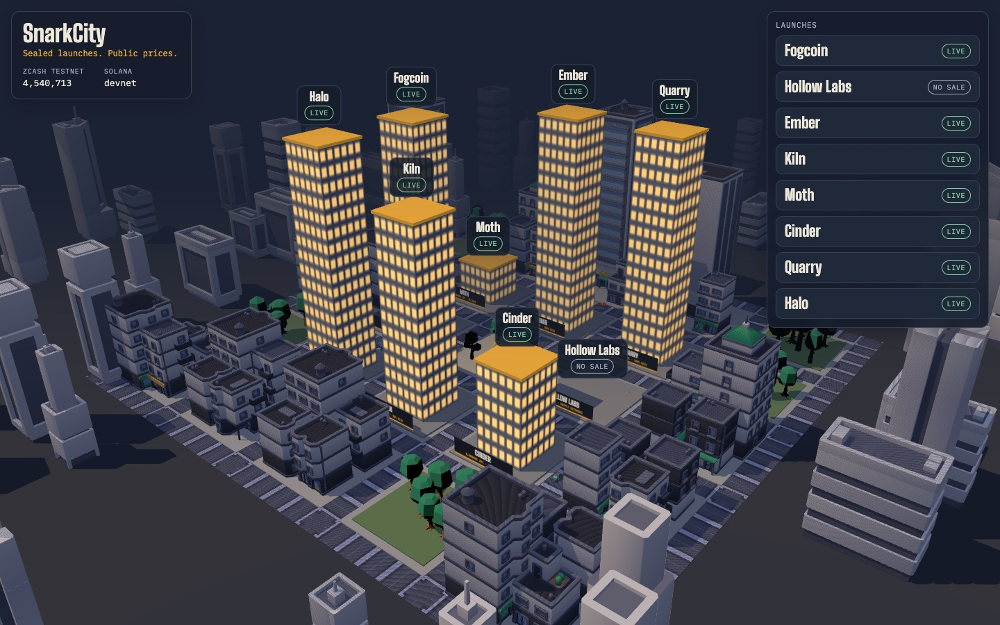
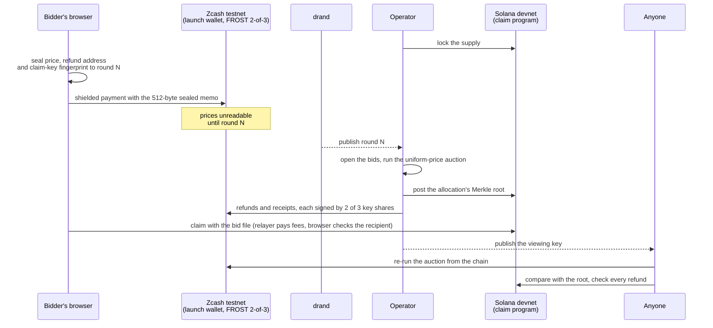

# SnarkCity

**Sealed launches. Public prices.**



A new token launches. Bots read every bid in the mempool and buy in front of it. Insiders take the cheap allocation. Large buyers get copied or hunted. By the time an ordinary buyer's order lands, the price has already moved against them. On a public chain, the act of bidding is itself the leak.

SnarkCity is a token launchpad where bids are sealed. Each bid is a shielded Zcash payment, and its price is time-locked so nobody can read it until bidding closes, not other bidders and not the launch operator. When the window closes, one uniform-price auction sets a single clearing price that every winner pays. Tokens are claimed on Solana. Anyone can re-run the whole auction from the Zcash chain with the launch's published viewing key and check that the result and every refund are right.

Built for ZECATHON (Private Markets track). Everything below runs on Zcash testnet and Solana devnet.

**See it in your browser:** [leihyn.github.io/snarkcity](https://leihyn.github.io/snarkcity/), a snapshot of the live city. Open any launch, check its audit and download its viewing key, or make a real sealed bid on Lantern (sealing runs in your browser; paying needs a Zcash testnet wallet). Claiming needs the live server.

## Proven on testnet

Each line links to a transaction that shows it. The Zcash explorer shows that a shielded payment happened, never its amount or memo.

- **Prices stay sealed until drand opens them.** Halo's close refused to run until drand published round 33373748. Then the bids opened, and the public audit opened them again on its own.
- **One price for every winner.** Quarry's four bids cleared at 0.000003 ZEC per token. A partial fill, a losing bid and a late bid were refunded in [one payment](https://blockexplorer.one/zcash/testnet/tx/a5b8d2ae0b10ff38147609510a42c13cf21a12570a1e66981b718e5323d7c5fd).
- **Two of three keys sign every refund.** A 2-of-3 FROST key [spent on the current NU7 testnet](https://blockexplorer.one/zcash/testnet/tx/a68f1077570133a25e614756fe17ed48959167649b3b902be3c979b2cd4b47af), then signed each of Halo's payouts ([one of them](https://blockexplorer.one/zcash/testnet/tx/6ff7e56d8a27c82009c8f9e9fc05e25dc44edc1d674c1f9db0e0596cfa3e5f6d)) and [Ashfall's refund](https://blockexplorer.one/zcash/testnet/tx/fc340da84ea11d4aaa4e6d217b363884614e076a5db8f2e1cc3ab4703fb9d302).
- **A claim pays only the address you chose.** The browser checks the relayer's transaction before signing it: [a claim on Solana devnet](https://explorer.solana.com/tx/5WJVFUWbwKpfTyjXkt1a9FEpRiH7TxMbDs9qcWXdUWkpqbF3Hqt3m8E298NL5kxNw3ABvrhracAxzjx15Khsgc7D?cluster=devnet).
- **Anyone can check the result.** Each launch publishes its viewing key. The audit re-runs the auction from the Zcash chain, compares it with Solana, and checks every refund.

## What it does

- **Sealed bids.** A bid is a shielded Zcash payment whose memo carries the bidder's maximum price, a refund address and the fingerprint of a fresh claim key. The browser time-locks that memo to a [drand](https://drand.love) round set at the window's close. drand is a threshold network run by independent organisations; until it publishes that round, the bid cannot be opened by anyone.
- **One public price.** A uniform-price auction: bids are ranked by price, the clearing price is the lowest at which demand fits the supply, everyone who wins pays it, the bid at the margin is partly filled, and everything not spent is refunded.
- **Tokens on Solana.** The supply is locked in a claim program before bidding opens. At close, the allocation's Merkle root goes on-chain and each winner claims with the key from their bid file. A relayer pays the fees, so the bidder needs no SOL, and the browser checks the claim pays the address it chose before signing.
- **Anyone can audit.** Once the result is final, the launch publishes its Zcash viewing key. With it, anyone can re-run the auction from the chain, compare it with what Solana holds, and check every refund was paid in full.
- **No single key holds the money.** A launch wallet can be a 2-of-3 FROST key: it receives bids as a watch-only wallet, and every refund needs two of three key holders to sign.
- **A city.** Each launch is a building. Bidding is fog, closing lifts it, the tower's height is how much sold, and its windows light up as winners claim.

## Try it

**What you need:**
- Node 23.6 or later (built with Node 25).
- [zcash-devtool](https://github.com/zcash/zcash-devtool) built at commit `0b3436b`. It talks to `testnet.zec.rocks`.
- A Solana devnet keypair with a little SOL (`solana airdrop`).
- Testnet ZEC (TAZ) from the faucet at faucet.testnet.valargroup.dev.

```sh
(cd relayer && npm ci) && (cd web && npm ci)
node relayer/scripts/serve.ts city.json   # the city at http://127.0.0.1:5174
```

`city.json` lists the launches to show (see the top of `relayer/scripts/serve.ts`).

**Run a launch:**

```sh
node relayer/scripts/frost-wallet.ts launch.json <synced-wallet> <frost-client> <zcash-sign> <frost-sign2>   # optional: FROST custody
node relayer/scripts/open-launch.ts launch.json    # locks the supply on Solana, opens bidding on Zcash
# bidders use the city's bid screen, or watcher/scripts/make-bid.ts
node relayer/scripts/close-launch.ts launch.json   # opens the bids, settles, posts the root, pays refunds
node relayer/scripts/seed-pool.ts launch.json      # opens the trading pool at the clearing price, burns the LP
node relayer/scripts/audit-launch.ts launch.public.json launch.viewkey.txt ./audit-wallet <zcash-devtool>
```

A launch file names the wallet, the window (`biddingBlocks`, at least 20), the supply and reserve price, and is sealed with drand unless it says `"sealed": false`.

## How it works



The parts:
- `auction/` is the clearing engine and the Merkle tree.
- `watcher/` reads the launch wallet (through zcash-devtool's database), opens sealed bids, settles, plans refunds and runs the audit.
- `program/` is the Solana claim program (Anchor), deployed on devnet at `WA7VpLkfVh5HhCdfxHPosru9FEbTyUJUwUZhEkqe4Fu`.
- `relayer/` holds the operator scripts, the claim relay and the city's server.
- `web/` is the city, plus the bid, claim and audit screens. The bid screen's crypto runs in the browser with WebCrypto.
- `frost/` holds the FROST signer and its README.
- `deploy/` holds the container and static-snapshot tooling.

### Why the bid memo looks like that

A sealed bid is a ZIP 302 arbitrary-data memo: `0xFF "SC2"`, the drand round, a 32-byte key encrypted to that round (tlock IBE on BLS12-381, 160 bytes), then the bid under AES-256-GCM. The header is authenticated, so the round cannot be swapped. Every sealed memo is exactly 512 bytes, so its length says nothing about the refund address. drand's key is pinned in `web/src/seal.js`: a launch cannot name its own key, or an operator could seal bids to a key it holds.

### Why a bid can be "late" even inside the window

The window is measured in Zcash blocks; drand releases its key at a clock time. If blocks run slow and the key comes out before the last block, anyone could read the open bids and bid knowing them. So a bid mined in a block timestamped at or after the reveal counts as late and is refunded in full.

## Trust model

**Who sees what, and when:**

| | During bidding | After the result is final |
|---|---|---|
| Who bid (the sender) | Nobody | Nobody |
| A bid's price, refund address, claim fingerprint | Nobody (sealed) | Everyone (opened with drand, readable with the viewing key) |
| A bid's amount and arrival time | The launch wallet | Everyone (viewing key) |
| The clearing price and allocation | Nobody | Everyone |

**What you trust, and what you don't need to:**
- **drand's threshold network** not to collude to release a round early. That's the only way bids open before the close.
- **The operator to pay refunds,** but not on its word. The public audit shows any refund missing, short or sent to the wrong address. With FROST custody, two of three key holders must sign every payout.
- **The operator to publish a correct result,** again not on its word. The audit re-runs the auction from the chain and compares it with the Merkle root on Solana.
- **The relayer: nothing.** The claim key signs the whole transaction, and the browser refuses to sign one that pays anyone but the address you chose.

**What it does not hide:**
- **Payment amounts during bidding.** The launch wallet sees each payment's amount arrive, so the operator knows total demand, but not at what prices. The operator could still bid against its own launch without seeing the others; with prices sealed, that works like a hidden reserve price rather than a targeted manipulation.
- **The link between a claim and its bid, once the result is public.** A claim on Solana reveals the claim key's fingerprint, which the opened bid also carries, so a claim can be matched to its bid's amount, price and refund address. Never to who paid. The claim screen defaults to a fresh address made from the bid's own key, tied to nothing until you move the tokens, and says so plainly.
- **Refund-address reuse.** A refund address used in two launches links those bids. The bid screen asks for a fresh one.

## What is real, and what stands in

### Why the token is on Solana

Everything private happens on Zcash: the bids, the money, the refunds and the audit. Solana only holds the public token ledger, because Zcash has no custom tokens on mainnet yet. Zcash Shielded Assets (ZIPs 226 and 227) would add them. With them, the issuer would send each winner their tokens in a shielded payment, and the audit would check those payments the way it checks refunds today.

| Part | Status |
|---|---|
| Shielded bids, encrypted memos, refunds and receipts on Zcash testnet | Real |
| drand time-locked bids, opened at close and in the audit | Real (drand mainnet "quicknet") |
| 2-of-3 FROST custody of the launch wallet, signing on the current NU7 testnet | Real. The launches' keys came from a trusted dealer; key generation by DKG, with no dealer, is proven separately on testnet (see `frost/README.md`) |
| Uniform-price auction, Merkle claims, relayed claims on Solana devnet | Real |
| Public audit from the viewing key | Real |
| Trading pool on Raydium (CPMM, devnet), LP burned | Real pool. Its SOL side is seeded by the creator, priced by the quote below |
| ZEC to SOL conversion through NEAR Intents | Quote only. NEAR Intents runs on mainnet only; `relayer/scripts/swap-raise.ts` requests a real deposit address for a mainnet run but never sends funds |
| Tokens on Zcash | Not possible yet. Zcash shielded assets (ZSAs) are not on mainnet, so the tokens live on Solana |

Note on the conversion: 1Click's ZEC deposit address is transparent (`t1…`). Converting a raise makes that one payment's amount public; the bids and bidders stay shielded.

## Evidence

Launches run end to end on testnet and devnet (bid, close, refunds, claim, audit):
- **Fogcoin (two bids), Ember, Kiln, Moth, Cinder (one bid each):** every allocated token claimed. Moth's bid was placed by a person through the browser.
- **Hollow Labs:** no sale. Two late bids were refunded and the supply went back to the creator.
- **Quarry:** price discovery.
  - Four competing bids cleared at 0.000003 ZEC per token. The bids at 0.000005 and 0.000004 won in full, the bid at 0.000003 was partly filled with 0.00099999 ZEC refunded, the bid at 0.000002 lost and was refunded in full, and a late bid was refunded.
  - All five payouts went out in one transaction, `a5b8d2ae…`, and the audit checks out.
- **Halo: sealed bids plus FROST custody.**
  - The same five bids as Quarry, each a 512-byte sealed memo made in the browser.
  - `close-launch` refused to settle until drand published round 33373748. It then opened the bids and reached Quarry's result: 0.000003 ZEC per token.
  - All five payouts were signed by two of the launch's three FROST key shares, one transaction each (`3d339a08…`, `6ff7e56d…`, `47052e6f…`, `09cbbcc5…`, `d1d8df21…`). A re-run reported "0 due, 5 already paid".
  - The public audit opened the bids with drand on its own and checks out.
  - The three winners claimed 2,000 tokens through the browser.
- **Ashfall: a sealed no-sale with FROST.** Its one sealed bid was mined after the window, so nothing sold: the supply went back to the creator on Solana and the bid was refunded in full by a payment signed with two of three FROST key shares.
- **Spire: sealed price discovery with FROST.** Four sealed bids competed for 3,000 tokens. The price cleared at about 0.00000317 ZEC per token, where the three highest bids exactly fill the supply, so those three won in full. The bid at 0.000003 lost and was refunded, and a bid mined after the window was refunded as late. All five payouts were signed with two of three FROST key shares, and the public audit opened the bids with drand on its own and checks out.
- **Lantern: open to bids.** A sealed FROST launch taking bids until Zcash block 4,564,151 (around 1 November 2026), time-locked to drand round 33789607, which opens on 8 November.
- **FROST on NU7 testnet:** a 2-of-3 key received 0.004 TAZ in the Ironwood pool and spent 0.003 TAZ back. Transaction `a68f1077570133a25e614756fe17ed48959167649b3b902be3c979b2cd4b47af`, height 4539854.

Tests: `npm test` in `auction/`, `watcher/`, `relayer/` and `web/`. Several tests use real drand beacons pinned in the test, and a planted bug in each security check (round authentication, the late-bid rule, the claim recipient check) makes them fail.

## Security notes

- **npm audit** reports 13 advisories in `relayer/`'s dependencies (6 high), all through the standard Solana libraries (`@solana/web3.js` 1.x, `@solana/spl-token`, Anchor); the Raydium SDK adds none of its own. The offered fixes are a major web3.js upgrade or a years-old spl-token downgrade. Whether each advisory is reachable from SnarkCity's code has not been traced. For a devnet demo they are recorded here rather than changed days before the deadline; a mainnet build should move to `@solana/kit`.
- **The backend drives zcash-devtool,** Zcash's developer CLI, rather than a wallet library. It is the quickest way to the current testnet (NU7, Ironwood pool) and PCZT signing; a production service would use the librustzcash crates directly.
- **Keys never go in the repo** (`.gitignore`). The hosting image holds none (`deploy/README.md`).

## Known limits and their fixes

| Limit | Why it happens | The fix |
|---|---|---|
| The launch wallet sees each bid's amount while bidding is open | The amount is the payment, and the receiving wallet has to read it | Fixed-size deposits: every bidder sends the same deposit, the real budget goes inside the sealed memo, and the rest is refunded. The operator learns only how many bids came in |
| Once the result is public, a claim links to its bid (never to who paid) | The claim reveals the claim-key fingerprint that the opened bid carries | A small claim privacy pool: a membership proof with a nullifier, allocations split into fixed claim sizes, claims spread over time |
| FROST signing runs in one process holding two shares | The demo signs with `frost-sign2`, which needs two shares at once | Each key holder signs on their own machine with `frost-client participant` through `frostd`. Key generation already uses DKG ([a DKG key spending on testnet](https://blockexplorer.one/zcash/testnet/tx/9cba1c2e5f8a5cb31a0550da58ebde1b3ebbb9183608dcb719629205dd9fd121)), so no dealer ever holds the whole key |
| The tokens live on Solana | Zcash has no custom tokens on mainnet yet | Zcash Shielded Assets, once they are live |

**For mainnet:** the NEAR Intents conversion executed rather than quoted, and legal review.

## Troubleshooting

**`close-launch` says "not ready to settle: bids unseal at drand round …"**
The bids are sealed until that round. Re-run after the time shown; drand publishes a round every 3 seconds.

**`close-launch` says "payouts waiting … funds are still confirming"**
Received notes need 10 confirmations before they can be spent. Re-run in a few minutes. Payouts are never sent twice: a re-run sees the ones already sent.

**zcash-devtool fails with "No such file or directory" or connection errors**
The testnet server drops connections now and then. Read calls retry on their own; for `wallet init`, run it again.

**A no-sale launch says "payouts waiting … send the launch wallet a fee float"**
Refunding a bid in full leaves nothing to pay the network fee with. Send the launch wallet a small payment with no memo (0.0002 TAZ is plenty) and re-run `close-launch`. A payment with no bid memo is not a bid and is not refunded.

**`zcash-devtool wallet pay` waits forever in a script**
It asks "Continue? [y/n]" before sending. Pass `--disable-confirmation` when paying from a script.

**The bid screen's QR code will not scan**
A sealed bid's payment link is long (512-byte memo). Use "Copy payment link" and paste it into your wallet, or the command shown under "Paying from the command line".
